# PharmaOS — Architecture

> How the system is put together and why. Companion to `problemstatement.md` (what and why) and `implementationplan.md` (build steps, formulas, fixtures). When this file and the plan disagree, the plan wins and this file is fixed in the same commit.
> Version 1.0 · 21 Oct 2026 · Next.js 16.4 · Postgres (Supabase) · Gemini

---

## 1. Architecture in one paragraph

PharmaOS is a **web-based dashboard**: a single Next.js web application that users open in a desktop browser (no mobile or desktop app). The browser renders the dashboard. Server components and route handlers call a **services layer**, which reads one consistent snapshot of the database, passes it through a **pure decision engine**, and writes results back in transactions. An **AI orchestrator** sits beside the API routes and reaches the same engine only through typed, read-mostly tools. It explains and adjusts plans but can never approve, create or send a purchase order. Postgres is the single source of truth for the plan screens, the PO screens and the 3D warehouse. Every number comes from deterministic, unit-tested code, and every change is written to an append-only audit log.

### 1.1 Quality goals (in priority order)

| # | Goal | What it means here | Main mechanisms |
|---|---|---|---|
| Q1 | **Correctness** | Quantities, prices, totals and scores are exactly right | Pure engine, decimal money, integer packs, fixture tests F1–F9 |
| Q2 | **Trust and traceability** | Every recommendation can be explained and audited | `evidence_json`, reason codes, append-only `audit_logs`, provenance labels |
| Q3 | **Human control** | Nothing is committed without a person | Approval-only PO creation, no LLM write tools for POs, nothing sent externally |
| Q4 | **Resilience on demo day** | The demo works if the AI, WebGL or network fails | Deterministic fallback, 2D grid, local Postgres option, backup video |
| Q5 | **Buildable by one person in 30 hours** | Few moving parts | One app, one database, no queues, no microservices, no agent framework |

### 1.2 Constraints

- One builder, 30 hours, a hackathon demo (problemstatement §8).
- One workflow only: intelligent procurement. No other modules (mentor feedback).
- All data is synthetic demo data shaped by reference datasets. No reference row is copied (plan §5).
- Web dashboard only, for desktop browsers (latest Chrome or Edge, 1280 px wide and up; usable on a tablet). No native mobile or desktop app.
- No authentication and no external integrations. Nothing leaves the system except calls to the Gemini API.

---

## 2. System context

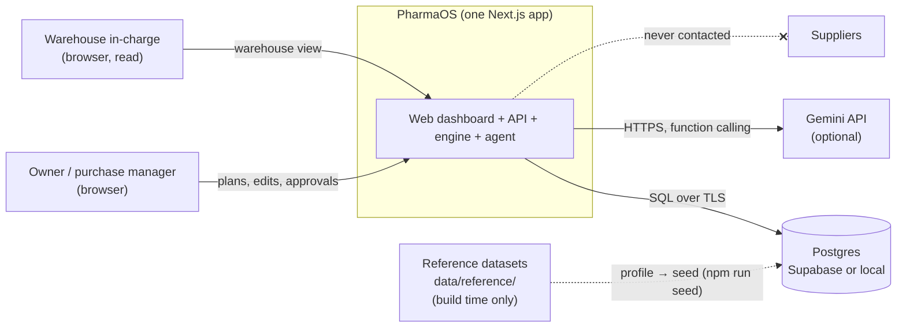

| External actor | Interaction | Trust |
|---|---|---|
| Browser user | HTTP to the Next.js app | Untrusted input; every body validated with Zod |
| Postgres | `DATABASE_URL`, postgres.js pool | Trusted store; constraints are the last line of defence |
| Gemini API | `GEMINI_API_KEY`, server-side only | Untrusted output: function-call arguments re-validated, text never parsed for numbers |
| Reference datasets | Read only by the seed scripts | Patterns only; never loaded as rows |
| Suppliers | None. Draft POs stay inside the app | — |

---

## 3. Containers and layers

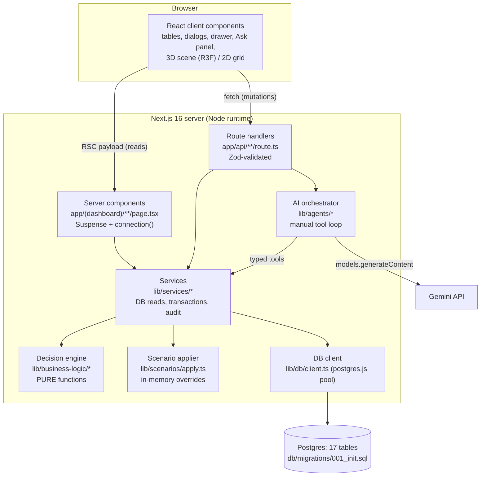

### 3.1 Layer responsibilities

| Layer | Folder | Does | Must not |
|---|---|---|---|
| UI (client) | `components/**` | Render, collect input, call routes, `router.refresh()` | Compute totals, talk to DB or Gemini |
| Pages (server) | `app/(dashboard)/**` | Read via services inside `<Suspense>`, pass props to client components | Mutate data |
| API | `app/api/**/route.ts` | Parse and validate, call one service, map errors to HTTP | Contain business logic |
| Agent | `lib/agents/` | Run the tool loop, enforce tool allow-list, fall back | Approve, reject or create POs; run SQL; state numbers not returned by tools |
| Services | `lib/services/` | Load context, call engine, run transactions, write audit | Re-implement engine maths |
| Engine | `lib/business-logic/` | All maths and rules, deterministic | Import DB, network, `Date.now()` or `Math.random()` |
| Scenarios | `lib/scenarios/` | Apply scenario params to a loaded context, in memory | Write scenario effects into seed tables |
| Data access | `lib/db/` | Pool and typed queries | Business decisions |

### 3.2 Dependency rules (enforced by review; violating one is a bug)

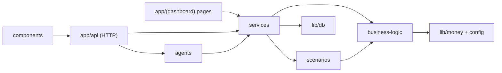

- `lib/business-logic` imports only `lib/money.ts`, `config.ts` and its own files.
- Nothing imports `lib/db`, `lib/services` or `lib/agents` from a `"use client"` file (R10: keys and pool stay on the server).
- Only `lib/services/approval.ts` inserts into `purchase_orders` or `purchase_order_lines`.
- Only `lib/services/audit.ts` inserts into `audit_logs`.

---

## 4. Code map

| Concern | Files | Notes |
|---|---|---|
| Schema | `db/migrations/001_init.sql` | 17 tables, `po_number_seq`, append-only trigger, seeded `scenarios` + `app_state` |
| Migrations | `scripts/db/migrate.ts` | Applies `*.sql` once each, tracked in `schema_migrations`; `--reset` drops the public schema |
| Seed | `scripts/seed/*` | Profile references → generate → inject demo cases → validate → write |
| Money | `lib/money.ts` | `dec`, `roundMoney` (2 dp half-up), `roundUnit` (4 dp), `sumMoney`, `formatINR` |
| Engine config | `lib/business-logic/config.ts` | Every tunable constant (horizon, R, safety, risk window, weights) |
| Engine | `lib/business-logic/{dates,types,demand,expiry,inventory,ordering,supplier-scoring,totals,priority,basket,impact,validation,heatmap,putaway,engine}.ts` | Plan §6 |
| Tool contract | `lib/validation/tool-contract.ts` | `ToolResult<T>`: `{ ok, data | error, warnings, source_timestamp }` |
| API schemas | `lib/validation/api.ts` | Zod schema per route |
| Services | `lib/services/{context,as-of,dashboard,plans,approval,purchase-orders,warehouse,scenarios,audit,explain}.ts` | Plan §7 |
| Agent | `lib/agents/{tools,prompts,orchestrator}.ts` | Plan §9 |
| Pages | `app/(dashboard)/{page,procurement,procurement/[planId],warehouse,purchase-orders,purchase-orders/[poId],activity,data}` | Plan §10 |
| Routes | `app/api/**` | Plan §8 |
| Warehouse UI | `components/warehouse3d/{WarehouseView,Scene3D,Grid2D,BinPanel,Legend,ModeSelect}.tsx` | Plan §11 |

---

## 5. Data architecture

### 5.1 Entity relationships

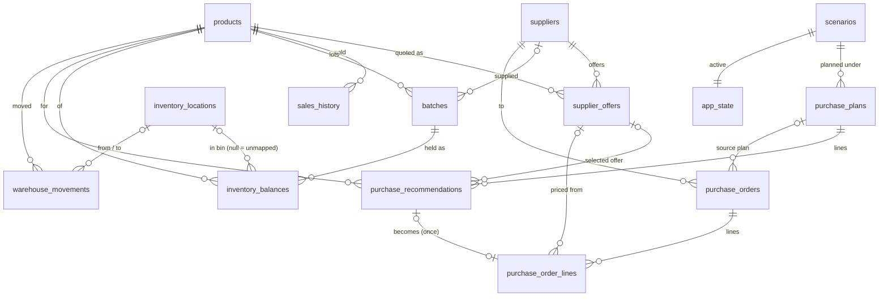

Stand-alone tables: `approvals` (polymorphic `entity_type` + `entity_id`), `audit_logs` (append-only, polymorphic), `data_sources` (data dictionary), `schema_migrations` (created by the migration runner).

### 5.2 Table groups

| Group | Tables | Written by | Read by |
|---|---|---|---|
| Master | `products`, `suppliers`, `supplier_offers`, `inventory_locations`, `data_sources` | Seed only | Engine context, UI |
| Operational state | `sales_history`, `batches`, `inventory_balances`, `purchase_orders` (status `open`/`received`/`cancelled`) | Seed only | Engine context, warehouse |
| Control | `scenarios`, `app_state` | Seed; scenario and settings services | Context loader, top bar |
| Planning | `purchase_plans`, `purchase_recommendations` | `plans.ts`, `approval.ts` | Plan screens, agent tools |
| Execution | `purchase_orders` (status `draft`…`exported`), `purchase_order_lines`, `approvals` | `approval.ts`, `purchase-orders.ts` | PO screens |
| History | `audit_logs`, `warehouse_movements` | `audit.ts`; P2 put-away simulation | Activity screen |

### 5.3 Invariants and where they are enforced

| Invariant | Engine / service | Database |
|---|---|---|
| Quantities are whole packs, never negative | Types + validation | `integer` + `check (… >= 0)` / `> 0` |
| Money is exact | `lib/money.ts` | `numeric(12,4)` unit, `numeric(14,2)` totals |
| Plan never exceeds budget | Basket guarantee + edit refusal (409) | `check (proposed_total <= budget_limit)`, `budget_remaining >= 0` |
| Reserved stock never exceeds on-hand | Seed validation | `check (reserved_qty <= on_hand_qty)` |
| One balance per batch per bin (incl. unmapped) | Seed | unique index on `(batch_id, coalesce(location_id, nil-uuid))` |
| A recommendation becomes a PO line once, ever | `approveLines` checks | `purchase_order_lines.recommendation_id unique` |
| Same approval click never makes two POs | Idempotency lookup in the transaction | `unique (idempotency_key, supplier_id)` |
| Schemes are complete | Engine reads both or neither | `check ((scheme_paid_qty is null) = (scheme_free_qty is null))` |
| Audit history cannot change | Only `audit.ts` inserts | Trigger raises on update/delete |
| Prices are quotes, never MRP / ceiling | Generator + validation | `price_type in ('supplier_quote','purchase_invoice_price')` |
| Every row has provenance | Generator + validation | `data_source` check on every master and transaction table |

### 5.4 Data lifecycle and provenance

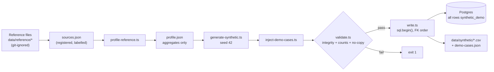

- **Phases:** D1 register + profile → D2 generate (stage 1). D3 (a real stockist export as `verified_customer_data`) is a later phase and needs no schema change.
- **No-copy guarantee:** `profile.json` holds only statistics. `validate.ts` fails if any generated brand, manufacturer or supplier name matches a reference file.
- **Reproducibility:** fixed seed (`app_state.synthetic_seed`), fixed as-of date, deterministic generator. A reset plus seed always gives the same database.

### 5.5 "Today"

`resolveAsOfDate()` = `DEMO_AS_OF_DATE` env → `app_state.as_of_date` → `max(sales_history.sale_date)`. The engine never reads the clock. Every plan stores its `as_of_date`, so an old plan can be re-explained exactly.

---

## 6. Decision engine architecture

### 6.1 Shape

The engine is a pure function of a **planning context** (plain objects; money as strings) and a **config**:

```
buildPlan(context, budget, ENGINE_CONFIG) → PlanResult { lines[], impact, assumptions }
analyseSku(skuContext, ENGINE_CONFIG)     → SkuAnalysis { status, offers[], chosen, qty, totals, priority, reasons[], warnings[], evidence }
```

No I/O and no clock. The same input gives a deep-equal output (fixture F9). This is what makes server recalculation, preview, approval re-validation and agent tools all agree: they call the same functions on the same context.

### 6.2 Per-SKU pipeline

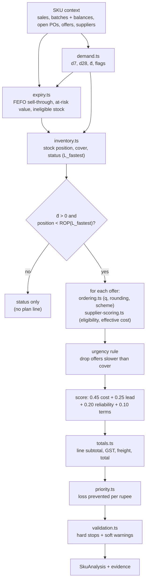

### 6.3 Plan pipeline

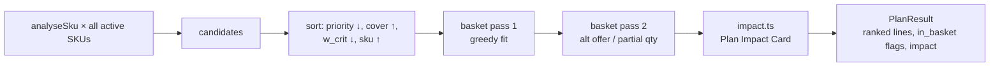

Guarantee: Σ in-basket `line_total` ≤ budget. The DB check on `purchase_plans` backs this up. Formulas, codes and fixtures are in the plan (§6, §14, Appendix B).

### 6.4 Evidence

Each line's `evidence_json` stores every input and intermediate value: daily series, d7/d28/d̄, batches with FEFO projection, ineligible stock, incoming POs, ROP/target/qRaw/rounding steps, all offers with exclusion codes and factor scores, chosen offer, totals, priority and config snapshot. The drawer, the deterministic explanation and the agent's tools all read from it. Nothing is recomputed differently for display.

---

## 7. Runtime flows

### 7.1 Create a purchase plan

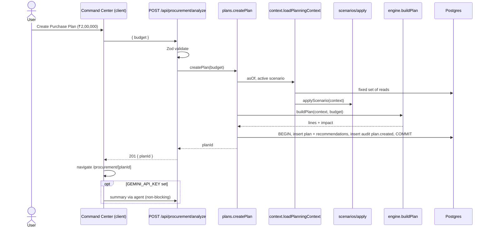

Target: under 3 seconds for 500 SKUs. The engine does no I/O, and context loading is a fixed number of queries.

### 7.2 Edit a line (preview, then save)

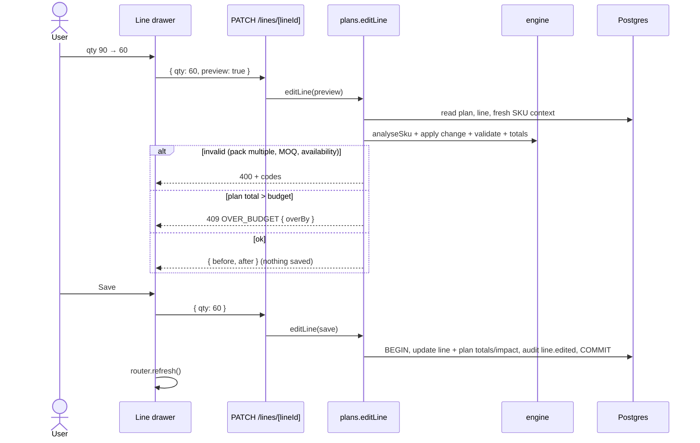

### 7.3 Approve lines: the only path that creates POs

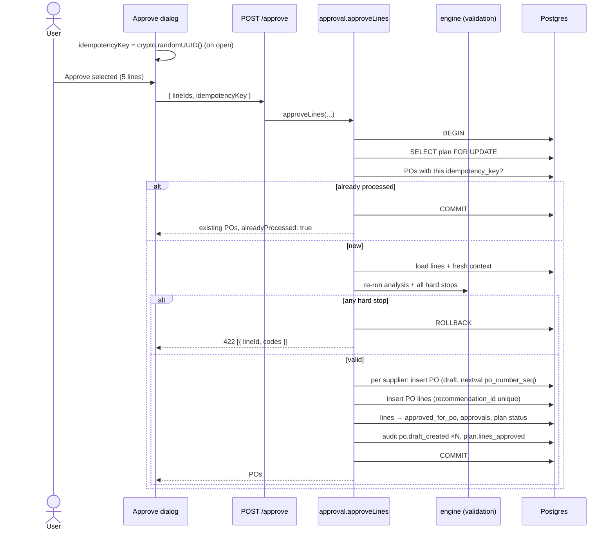

Concurrency: the `FOR UPDATE` lock serialises approvals on one plan. The unique constraints mean a racing duplicate fails instead of duplicating. A double click and a network retry both return the same POs.

### 7.4 Ask PharmaOS: agent tool loop

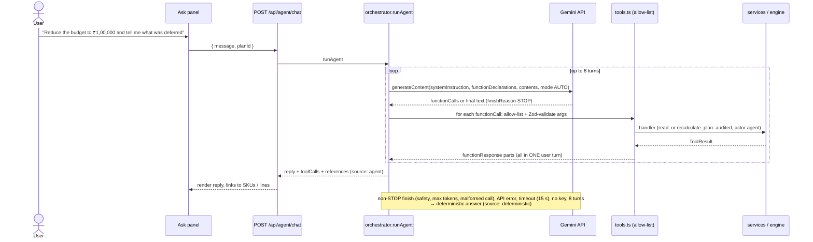

### 7.5 Why? (explanation with fallback)

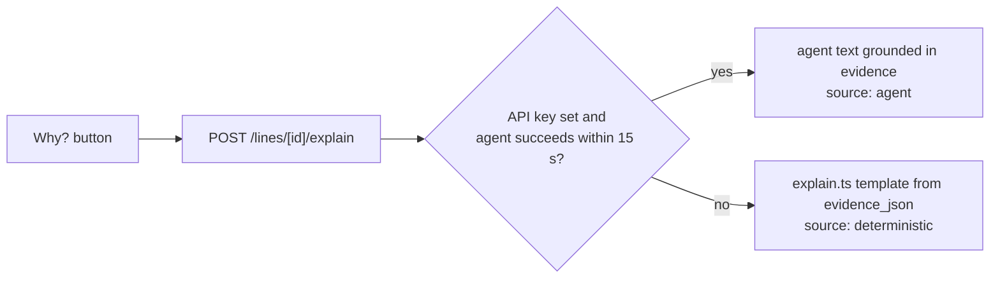

### 7.6 Warehouse view

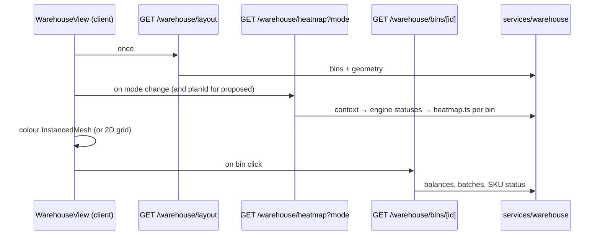

The heatmap is computed from the same engine statuses as the plan, so a red bin and a `STOCKOUT_RISK` line can never disagree. Proposed stock comes from the plan's in-basket lines plus `putaway.ts`.

### 7.7 Scenario run

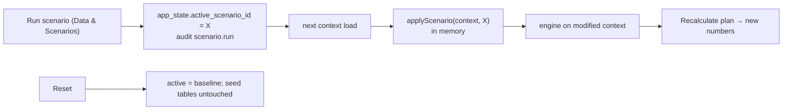

---

## 8. State machines

### 8.1 Recommendation

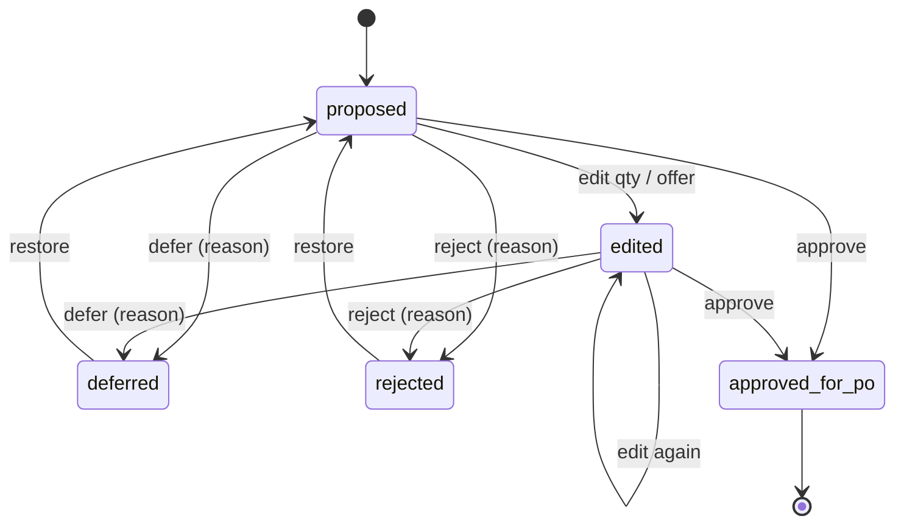

### 8.2 Plan

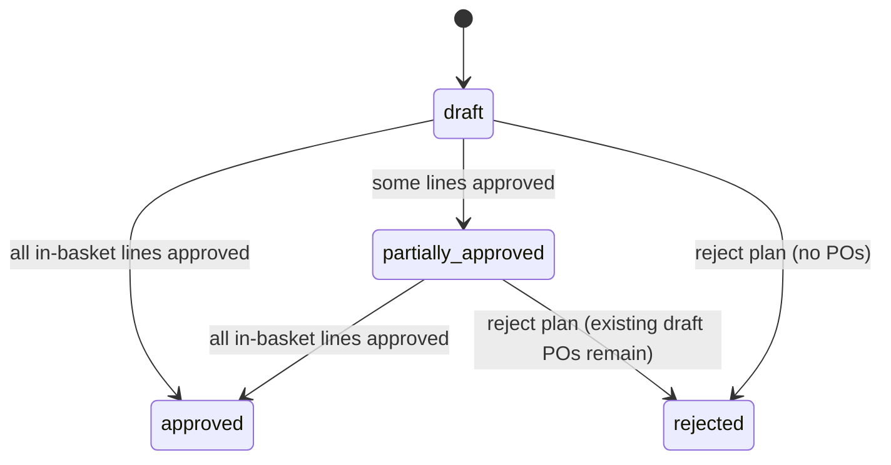

### 8.3 Purchase order

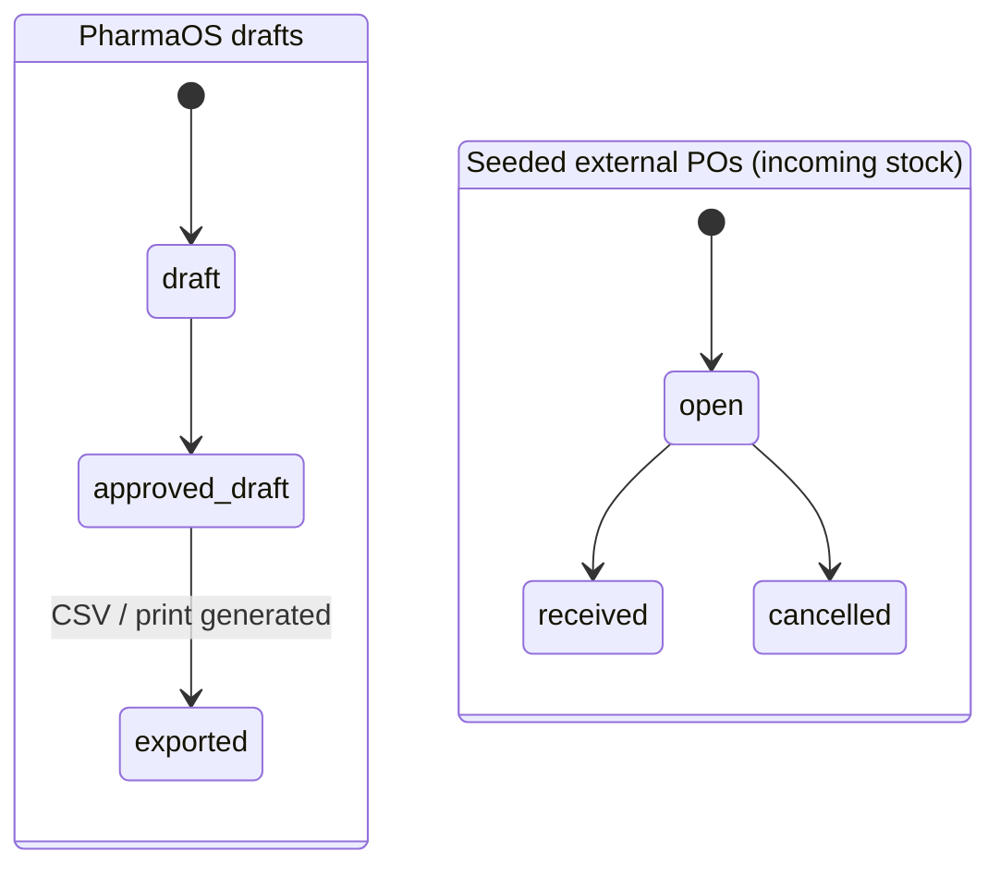

Statuses `sent`, `ordered` and `confirmed` do not exist anywhere in the system.

---

## 9. AI architecture

### 9.1 Boundary

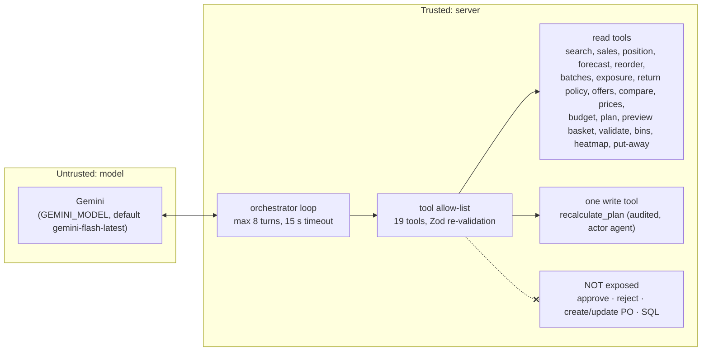

### 9.2 Guardrails and where each is enforced

| Guardrail | Enforced by |
|---|---|
| Model never produces numbers | System prompt plus architecture: all numbers come from tool results, and the UI renders figures from data, not from model text |
| No PO creation or approval by AI | Those tools do not exist; only `approval.ts` writes POs, and only through the HTTP approve route |
| Valid tool inputs | JSON Schema from Zod as `parametersJsonSchema`, automatic function calling disabled, plus a Zod parse of every `functionCall.args` before the handler; failures go back as `ToolResult` errors in the `functionResponse` |
| No product substitution, no safety calls | System prompt; no tool can change product identity |
| Ambiguous products | `search_products` returns exact identity fields; the prompt requires asking the user |
| Failures never block the user | Every AI entry point has a deterministic path (`explain.ts`, plan summary optional) |
| Stable instructions | Fixed `systemInstruction` and tool list; per-request facts (plan id, as-of) go in the user message |
| Gemini API rules | Function-calling mode `AUTO` (never `ANY`); model turn appended exactly as returned (keeps `thoughtSignature` parts); no hard-coded thinking config |

### 9.3 Where the AI appears

Behind three dashboard entry points (problemstatement §9.7, "dashboard, not chatbot"): plan summary after creation, the **Why?** button per line, and the optional **Ask PharmaOS** side panel.

---

## 10. Frontend architecture

### 10.1 Routing

| URL | File | Rendering |
|---|---|---|
| `/` | `app/(dashboard)/page.tsx` | Server component in `<Suspense>`; KPI tiles, critical SKUs; Create dialog (client) |
| `/procurement` | `procurement/page.tsx` | Server list |
| `/procurement/[planId]` (`?line=`) | `procurement/[planId]/page.tsx` | Server data → client PlanTable, ImpactCard, LineDrawer, Ask panel |
| `/warehouse` (`?mode= ?sku= ?bin=`) | `warehouse/page.tsx` | Client `WarehouseView`; `Scene3D` via `next/dynamic({ ssr: false })` |
| `/purchase-orders`, `/purchase-orders/[poId]` | `purchase-orders/**` | Server; print CSS; export via route |
| `/activity` | `activity/page.tsx` | Server, paginated |
| `/data` | `data/page.tsx` | Server summary + client scenario cards and ROI model |

`app/(dashboard)/layout.tsx` holds the sidebar and top bar. The root `app/layout.tsx` sets `className="dark"`, fonts and `<Toaster />`.

### 10.2 Server/client split and data flow

- **Reads:** server components call services directly (no HTTP hop), wrapped in `<Suspense>`, and call `await connection()` before the first query (Cache Components is on).
- **Mutations:** client components call route handlers with `fetch`, then `router.refresh()` to re-render the server components with fresh data. There is no client-side cache of business data. The server state is the truth.
- **Params:** `PageProps<'/…'>` / `RouteContext<'/…'>`, where `params` is a Promise.

### 10.3 Warehouse rendering

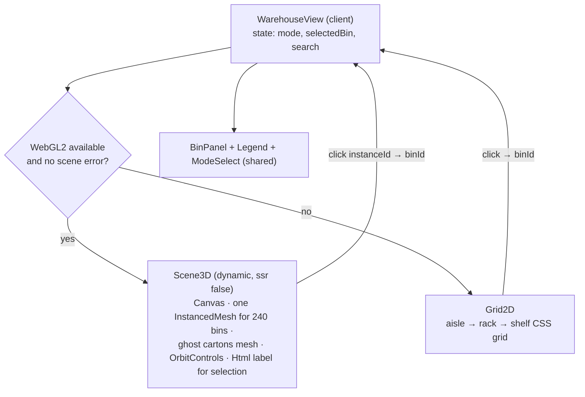

`frameloop="demand"` keeps the GPU idle when nothing changes. Colour is always paired with a text label in the panel and legend.

### 10.4 Design system

Dark navy surfaces, teal primary, and fixed status colours (stockout red, expiry amber, excess violet, healthy slate, proposed cyan ghost). Base UI–based shadcn components (`render` prop composition). Tabular numbers, INR formatting via `formatINR()`. Tokens are listed in plan §10.1.

---

## 11. API surface

Twenty route handlers, grouped by service. Full contracts are in plan §8.

| Group | Routes | Service |
|---|---|---|
| Dashboard | `GET /api/dashboard` | `dashboard.ts` |
| Planning | `POST /api/procurement/analyze`, `GET /api/purchase-plans/[id]`, `PATCH …/lines/[lineId]`, `POST …/recalculate`, `POST …/reject`, `POST …/lines/[lineId]/explain` | `plans.ts`, `explain.ts` |
| Approval | `POST /api/purchase-plans/[id]/approve` | `approval.ts` |
| Purchase orders | `GET /api/purchase-orders`, `GET …/[id]`, `POST …/[id]/export` | `purchase-orders.ts` |
| Warehouse | `GET /api/warehouse/layout`, `GET …/heatmap`, `GET …/bins/[id]`, `GET /api/products/search` | `warehouse.ts` |
| Scenarios | `GET /api/scenarios`, `POST …/[id]/run`, `POST …/reset` | `scenarios.ts` |
| Agent | `POST /api/agent/chat` | `lib/agents/orchestrator.ts` |
| Audit | `GET /api/audit` | `audit.ts` |

Error envelope: `{ error: { code, message, details? } }`. 400 = validation, 404 = missing, 409 = locked or over budget, 422 = hard stops at approval.

---

## 12. Cross-cutting concerns

### 12.1 Units and money

Integer packs everywhere. Unit prices are 4 dp and line amounts 2 dp, rounded half-up at defined points only (plan §6.7). postgres.js returns `numeric` as strings, and they go straight into `dec()`. Display formatting happens only at the edge (`formatINR`).

### 12.2 Validation layers

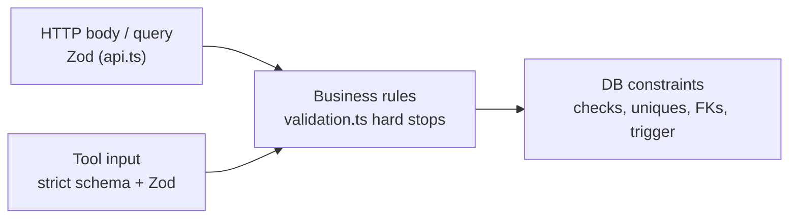

Each layer assumes the one before it can fail. The database is the final guard for the invariants in §5.3.

### 12.3 Transactions and concurrency

| Operation | Transaction scope | Concurrency control |
|---|---|---|
| Create plan | plan + all lines + audit | New rows only |
| Edit / defer / reject line | line + plan totals + audit | Status checks; last write wins (single demo user) |
| Recalculate | plan + changed lines + audit | Approved lines frozen |
| Approve | lock plan → POs → lines → statuses → approvals → audit | `SELECT … FOR UPDATE` + idempotency key + unique constraints |
| Seed | entire load | Run offline, before the demo |

### 12.4 Audit

All mutations go through `writeAudit({ actorType, actorId, action, entityType, entityId, before, after, reason })`. The action catalogue is in plan §13. Agent-initiated writes use `actor_type = 'agent'`. A DB trigger makes the table append-only.

### 12.5 Security

| Concern | Measure |
|---|---|
| Secrets | `DATABASE_URL`, `GEMINI_API_KEY` only in server env; never imported by client files; `.env*` git-ignored (except `.env.example`) |
| SQL injection | postgres.js tagged templates only; `sql.unsafe` reserved for migration files |
| Untrusted model output | Validated tool inputs, read-mostly tools, no free-form writes |
| Input size | Zod limits (e.g. chat message 1–2,000 chars, line arrays ≥ 1) |
| Auth | None (demo). `DEMO_USER` recorded as approver. Adding auth later only changes how `userId` is obtained |
| Data sensitivity | No patient or customer data; reference files git-ignored; all DB data synthetic |

### 12.6 Configuration

| Source | Holds |
|---|---|
| `.env.local` | `DATABASE_URL`, `GEMINI_API_KEY`, `GEMINI_MODEL`, `DEMO_AS_OF_DATE`, `DEMO_USER` |
| `lib/business-logic/config.ts` | All engine constants (copied into each plan's `assumptions_json`) |
| `app_state` row | Active scenario, default budget, optional as-of date, synthetic seed |
| `next.config.ts` | `cacheComponents`, `partialPrefetching`, Turbopack CSS rule |

### 12.7 Performance budget

| Path | Budget | How |
|---|---|---|
| Create plan (500 SKUs) | < 3 s | Fixed reads, in-memory engine, batched inserts |
| Edit preview | < 500 ms | Single-SKU analysis |
| Heatmap | < 500 ms | Context cached per request; 240 bins |
| 3D scene | 60 fps idle-free | One instanced mesh, `frameloop="demand"` |
| Agent reply | ≤ 15 s, else fallback | Timeout + deterministic path |

### 12.8 Observability

Hackathon-level only: the `audit_logs` screen, a `toolCalls` list in agent responses, server console logs for errors, and the measured "time to reviewable plan" logged by `createPlan` (reported in the pitch as the real measured number).

---

## 13. Failure modes and fallbacks

| Failure | Effect without a fallback | Fallback |
|---|---|---|
| No `GEMINI_API_KEY` / API error / safety block / timeout | No explanations or chat | `explain.ts` deterministic text; UI note "AI unavailable" |
| WebGL missing or scene crash | No warehouse | Error boundary → `Grid2D`; table view |
| Supabase or Wi-Fi down | No data | Local Postgres seeded identically (`DATABASE_URL` swap) |
| Reference file missing at seed time | Profile incomplete | Generator defaults; seed still validates |
| Duplicate approval / race | Duplicate POs | Idempotency key + unique constraints |
| Edit would exceed budget | Silent overspend | 409 `OVER_BUDGET` with amount |
| Stale or expired quote | Wrong supplier | Excluded at eligibility; hard stop at approval |
| Build-time caching error | Build fails | Suspense + `connection()` pattern; `npm run build` each stage |

---

## 14. Deployment and environments

```mermaid
flowchart LR
    subgraph local["Demo laptop (primary)"]
        dev["npm run build && npm run start<br/>http://localhost:3000"]
        lpg[("Local Postgres (backup)")]
    end
    subgraph cloud["Optional cloud"]
        vercel["Vercel (Node runtime)"]
        supa[("Supabase Postgres<br/>session pooler :5432")]
    end
    dev --> supa
    dev -.-> lpg
    vercel --> supa
    dev --> gemini["Gemini API"]
    vercel --> gemini
```

| Environment | Database | Notes |
|---|---|---|
| Development | Supabase or local Postgres | `npm run dev`; `db:reset` + `seed` any time |
| Demo | Same, freshly seeded before judging | Production build; backup video |
| Vercel (optional) | Supabase session pooler (:5432) | Env vars in the Vercel project; keep the pool small (`max: 4`, prepared statements on): session mode holds one server connection per client connection and allows 15 in total |

---

## 15. Architecture decisions

| # | Decision | Alternatives rejected | Reason |
|---|---|---|---|
| AD-1 | One Next.js app (UI + API + engine + agent) | Separate backend, microservices | Solo 30-hour build; one deploy; shared types |
| AD-2 | Pure engine in `lib/business-logic` | Logic in routes / SQL / LLM | Testable, deterministic, reused by every caller |
| AD-3 | postgres.js on plain Postgres | Supabase JS client, ORM | Real transactions with `FOR UPDATE`; minimal layers; portable to local Postgres |
| AD-4 | Plain SQL migrations | ORM migrations | The schema is the contract; checks and triggers are explicit |
| AD-5 | Decimal money + integer packs | JS numbers | No float drift in totals |
| AD-6 | Server-recalculated totals, preview endpoint | Client-side totals | Browser is never the source of truth |
| AD-7 | Approval-only PO creation with idempotency | Agent-created POs, client-side de-dupe | Human control; safe retries |
| AD-8 | Gemini (`@google/genai`) with a manual function-calling loop and an allow-list | Agent framework, SDK automatic function calling | Team's LLM choice; full control over allowed tools, validation, timeouts and fallback |
| AD-9 | Scenarios applied in memory | Mutating seed tables | Instant reset; seed integrity |
| AD-10 | Synthetic-only data from reference profiles | Loading public or team rows | Licence, provenance and honesty rules in the data acquisition plan |
| AD-11 | Instanced 3D + 2D fallback on the same API | Separate 3D data model, heavy assets | One source of truth; performance; resilience |
| AD-12 | Fixed as-of date | Wall clock | Reproducible demo numbers |
| AD-13 | Reads via server components, mutations via routes + `router.refresh()` | Client data fetching libraries | Fewer moving parts; always-fresh server state |

---

## 16. Traceability: principles → mechanisms

| Principle (problemstatement §9) | Architectural mechanism |
|---|---|
| 1. Procurement first | One workflow; every module feeds `buildPlan`; no other domains in the schema |
| 2. Deterministic numbers | Pure engine (§6), tool-only numbers for the AI (§9) |
| 3. Traceable | `evidence_json`, reason codes, `assumptions_json` config snapshot, audit log |
| 4. Human in charge | Approval-only PO path (§7.3), no AI write tools for POs, no external sends |
| 5. One source of truth | Same context + engine for plan, heatmap and agent; Postgres only |
| 6. Honest data | `data_source` + `data_sources`, `price_type`, no-copy validation, UI badge |
| 7. Dashboard, not chatbot | AI behind buttons and a side panel; all workflows work without it |

---

## 17. Evolution after the hackathon (not built now)

These points are named so the current design does not block them. None of them is in scope:

- **Customer data (phase D3):** an importer that writes `data_source = 'verified_customer_data'` into the same tables. No schema change is needed.
- **Authentication:** replace `DEMO_USER` with a session user in services. Audit and approvals already store a user id.
- **PO export to an ERP:** a new exporter beside the CSV export; status `exported` already exists.
- **Scheduled morning plan:** a cron route calling `createPlan`. The engine is already pure and fast.
